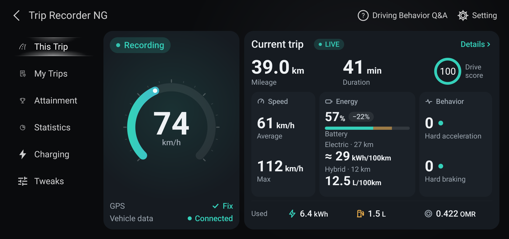
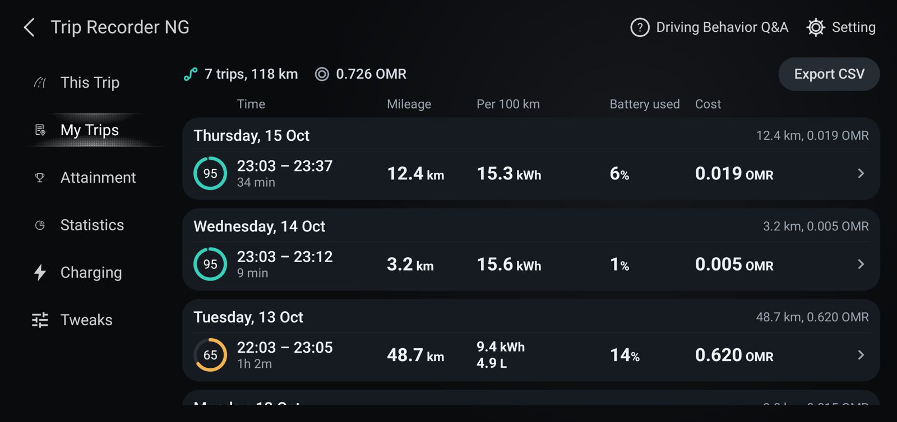
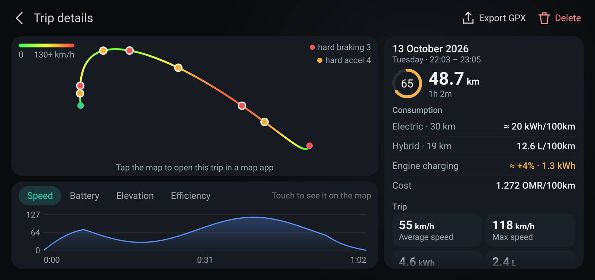
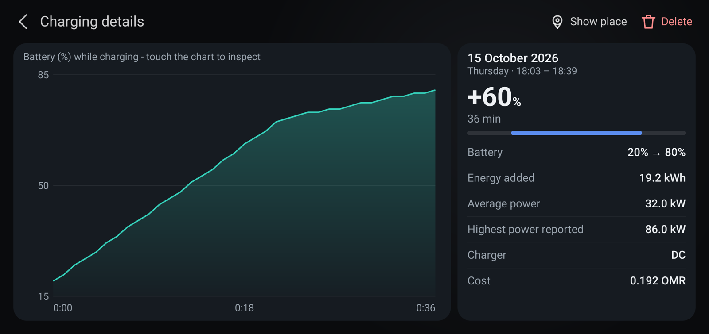
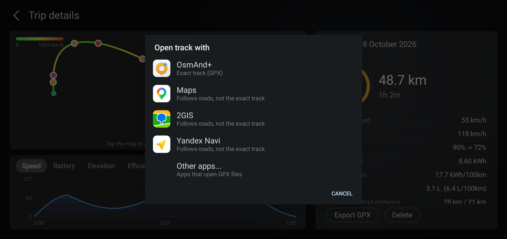
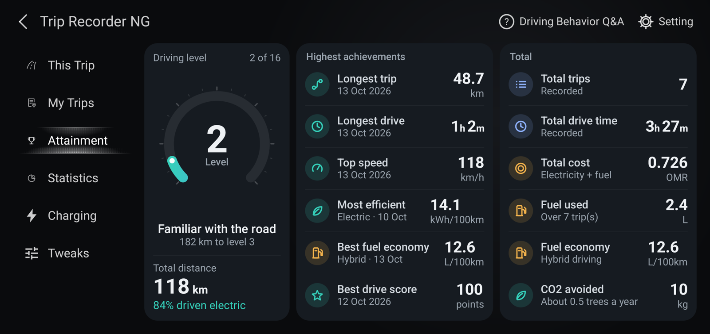
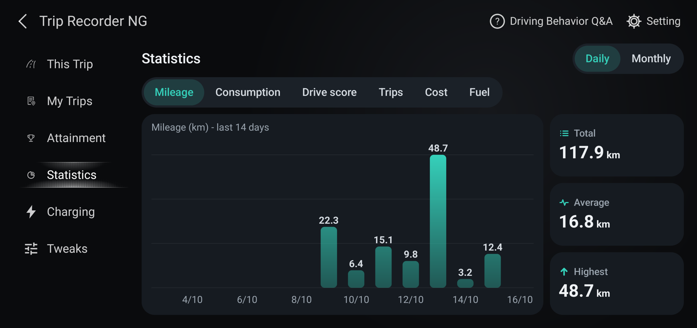
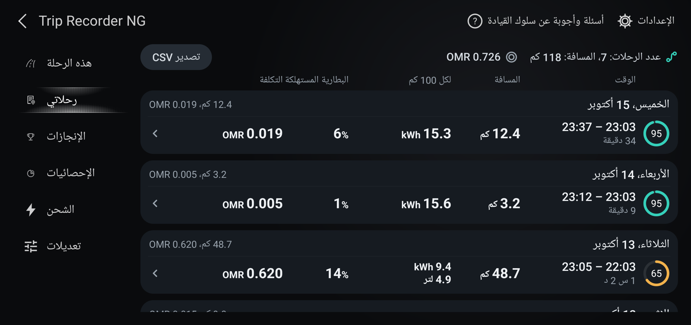
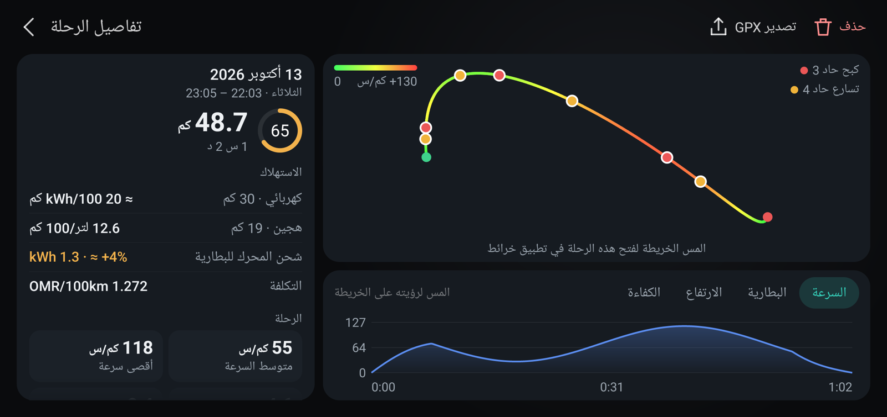

**العربية** | [English](README.md)

<h1 dir="rtl">Trip Recorder NG</h1>

مسجّل رحلات غير رسمي لسيارات BYD المزوّدة بوحدة شاشة DiLink. يسجّل كل رحلة قيادة على وحدة الشاشة نفسها (المسار والسرعة واستهلاك البطارية والطاقة والوقود وجلسات الشحن والتكلفة) ويعرضها في شاشات مصمَّمة على غرار تطبيق «سلوك القيادة» (Driving behavior) الأصلي من BYD: «هذه الرحلة» (This Trip) و«رحلاتي» (My Trips) و«الإنجازات» (Attainment) و«الإحصائيات» (Statistics) و«الشحن» (Charging) و«تعديلات» (Tweaks)، إضافةً إلى صفحتي الأسئلة والأجوبة و«الإعدادات» (Setting). كل شيء يبقى في السيارة ولا يُرفع أي شيء. التطبيق متوفر بالإنجليزية والعربية (مع واجهة من اليمين إلى اليسار للعربية).

اسم الحزمة `org.triprecorderng`. بُني واختُبر على سيارة واحدة هجينة قابلة للشحن بنظام DiLink 5.1 (أندرويد 13). وقد تختلف الحال في طرازات BYD وإصدارات البرمجيات الأخرى؛ والتقارير والإصلاحات مرحَّب بها.

> **غير تابع لشركة BYD.** «BYD» و«DiLink» علامتان مملوكتان لأصحابهما، وتُستخدمان هنا فقط لبيان ما يعمل التطبيق معه. اقرأ [إخلاء المسؤولية](#إخلاء-المسؤولية) قبل التثبيت.

## لماذا وُجد هذا التطبيق
يعتمد مسجّل الرحلات الأصلي من BYD، وهو جزء من تطبيق My Car («سلوك القيادة»)، على خادم تابع لـ BYD. وقد فرضت BYD قيودًا جغرافية على هذا الخادم، فلم يعد المسجّل يعمل في المناطق المتأثرة.

يسدّ Trip Recorder NG هذه الفجوة. فهو يسجّل النوع نفسه من البيانات مباشرةً على وحدة الشاشة، ويُبقي كل شيء في السيارة، ولا يحتاج إلى خادم BYD ولا إلى حساب BYD، ولذلك لا يستطيع قيد جغرافي أن يوقفه.

## لقطات الشاشة
لقطات من وحدة الشاشة في السيارة، تعرض الرحلات وجلسات الشحن التجريبية المضمَّنة في التطبيق.

| | |
|---|---|
|  |  |
|  |  |
|  |  |
|  |  |
|  | |

تظهر الشاشات العربية بتخطيط من اليمين إلى اليسار في منطقة المحتوى، مع بقاء القائمة على اليسار.

## البدء السريع
1. ابنِ ملف APK بالأمر `./build.sh` (انظر [البناء](#البناء)).
2. ثبّته على وحدة الشاشة عبر ADB: `adb install -r TripRecorderNG.apk` (تحتاج إلى وصول ADB إلى وحدة الشاشة؛ وتختلف طريقة تفعيله بحسب الطراز وإصدار البرمجيات).
3. افتح التطبيق واسمح بالوصول إلى الموقع.
4. في إعدادات السيارة > تطبيقات التشغيل التلقائي في BYD («Disable background Apps»)، أوقف مفتاح **Trip Recorder NG** (إيقاف المفتاح = مسموح له بالبدء)، ثم أعد تشغيل وحدة الشاشة مرة واحدة. بدون ذلك تمنع BYD التطبيق من البدء تلقائيًا. ويُعاد ضبط هذا المفتاح عند **كل** تثبيت أو تحديث (انظر [التثبيت والتحديث](#التثبيت-والتحديث)).
5. اختياري لكنه موصى به: فعّل «الإعدادات > رابط بيانات المركبة» (Setting > Vehicle data link) للحصول على بيانات البطارية والطاقة وعدّاد المسافة والوقود والشحن (انظر [رابط بيانات المركبة](#رابط-بيانات-المركبة-اختياري-ومتوقف-افتراضيًا)).

## إخلاء المسؤولية
- هذا مشروع هواية غير رسمي، يُقدَّم كما هو دون أي ضمان (انظر [LICENSE](LICENSE)). التثبيت والاستخدام على مسؤوليتك الخاصة. ولا تدعمه BYD ولا تُقرّه.
- يقرأ التطبيق بيانات المركبة عبر واجهة BYD الداخلية غير الموثَّقة الخاصة بالمركبة، وقد يغيّرها أو يعطّلها أي تحديث لبرمجيات السيارة. وكل ما يغيّره التطبيق في السيارة هو: مفتاح التجوال بالبيانات في أندرويد، وطلب الاتصال بسحابة BYD، ومفتاح AVAS (صوت السيارة الخارجي)، وإعادة تشغيل المودم، وذلك حين تضغط الزر أو تفعّل المفتاح في تبويب «تعديلات»؛ إضافةً إلى التطبيق نفسه حين تختار «تثبيت» بعد «التحقق من التحديثات» (إذ يستبدل نفسه بإصدار منزَّل من إصدارات هذا المشروع على GitHub وموقَّع بالمفتاح نفسه).
- يشغّل **رابط بيانات المركبة** الاختياري مساعدًا صغيرًا عبر خدمة التصحيح الموجودة في وحدة الشاشة نفسها على 127.0.0.1 (ADB عبر loopback)، بمفتاح ينشئه التطبيق بنفسه. وفي الوحدة التي جُرّب عليها قبلت السيارة هذا المفتاح دون أن تسأل، أي أن أي تطبيق على تلك الوحدة يستطيع فعل الشيء نفسه؛ وهذه خاصية في السيارة وليست في هذا التطبيق. أبقِ الرابط متوقفًا إن لم يكن ذلك مريحًا لك. إيقافه يوقف المساعد، و**حذف المفتاح** (Forget) يحذف المفتاح.
- لا تتعامل مع الشاشة أثناء القيادة. يسجّل التطبيق بنفسه ولا يحتاج إلى انتباهك على الطريق.

## الخصوصية
تُخزَّن الرحلات في قاعدة بيانات التطبيق نفسه على وحدة الشاشة. وتُكتب النسخ الاحتياطية وملفات التصدير (JSON وCSV وGPX) في `Documents/TripRecorderNG`، وهو مجلد مشترك يستطيع أي تطبيق يملك صلاحية التخزين قراءته. وهي تحتوي على مسارات GPS، فتكشف أين تسكن وأين تقود: احذفها أو لا تشاركها إن كان ذلك يهمّك. يطلب التطبيق صلاحية الإنترنت (INTERNET) للاتصالات المحلية (loopback) بالمساعد وبخدمة التصحيح في السيارة، ومن أجل **الإعدادات > التحقق من التحديثات**. ولا يتصل التطبيق بالإنترنت من تلقاء نفسه ولا يرفع أي شيء. فهو يتصل بـ GitHub (`api.github.com`، و`github.com` لتنزيل إصدار) فقط عندما تضغط «التحقق من التحديثات» أو «تثبيت»؛ وعندها يرى GitHub عنوان IP الخاص بالسيارة واسم إصدار التطبيق. أما فتح رحلة في تطبيق خرائط (من تفاصيل الرحلة) فيسلّم الرحلة إلى التطبيق الذي تختاره.

## ماذا يفعل التطبيق
- تبدأ خدمة تعمل في المقدمة (foreground service) عند الإقلاع وتسجّل الرحلات محليًا (SQLite). ولا يُرفع أي شيء.
- مصدر البيانات يُختار تلقائيًا، والخيارات بالترتيب (انظر `VehicleProvider`):
  1. استدعاء واجهة BYD الخاصة بالمركبة مباشرةً،
  2. استدعاء `autoservice` binder مباشرةً،
  3. المساعد الذي يعمل بمستخدم shell (فقط عندما يكون «الإعدادات > رابط بيانات المركبة» مفعّلًا، انظر أدناه)،
  4. **GPS فقط** (الخيار الاحتياطي؛ وتُكتشف الرحلات حينئذٍ بالحركة).
- ترفض السيارة الخيارين 1 و2 لأي تطبيق عادي (`SecurityException: permission deny`): فالقراءات تحتاج إلى صلاحيات `BYDAUTO_*_GET` على مستوى التوقيع، وهي صلاحيات لا يملكها إلا تطبيقات النظام.
- يسجّل وضع GPS فقط: السرعة والمسافة والمدة والمسار (مسار GPS) وأقصى سرعة ومتوسطها والتسارع/الكبح الحاد وتقييمًا بسيطًا للقيادة. تبدأ الرحلة بعد 3 ثوانٍ فوق 5 كم/س وتنتهي بعد 3 دقائق من التوقف التام؛ وتُهمَل الرحلات الأقصر من 50 م.
- غير متاح في وضع GPS فقط: حالة التشغيل ونسبة البطارية وعدّاد الطاقة وعدّاد المسافة (تظهر هذه الأعمدة بالعلامة «--»).
- التصدير: CSV (لكل الرحلات) وGPX (لكل رحلة) إلى `Documents/TripRecorderNG`.
- تفاصيل الرحلة: يفتح الضغط على المسار قائمة **فتح المسار باستخدام** (Open track with) بتطبيقات الخرائط المثبّتة في السيارة (`MapLink`، `TrackProvider`):
  - التطبيقات التي تستطيع فتح ملفات GPX، مثل OsmAnd، تتلقى الرحلة كملف GPX وترسم **المسار الدقيق** بما فيه الأجزاء خارج الطرق. وهذا هو الخيار المناسب عندما خرج المسار عن الطرق.
  - خرائط Google وYandex و2GIS لا تستطيع فتح GPX ولا رسم خط اعتباطي من رابط، لذا تتلقى الرحلة كمسار قيادة (البداية والنهاية وحتى 8 نقاط شكل كنقاط عبور). وهي تتبع الطرق بين تلك النقاط، ولذلك تضع القائمة عليها علامة «يتبع الطرق وليس المسار الدقيق» (أظهرت رحلة الاختبار البالغة 186 كم مسافة 207 كم في Maps)، وتحتاج إلى إنترنت في السيارة.
  - «تطبيقات أخرى» تسلّم ملف GPX إلى قائمة الاختيار في أندرويد نفسها (تطبيقات إدارة الملفات وعارضات GPX الأخرى).
  - تُبنى القائمة مما هو مثبَّت؛ وملف GPX نسخة مؤقتة في ذاكرة التخزين المؤقت للتطبيق ولا يستطيع قراءته إلا التطبيق الذي تختاره.

## هذه الرحلة
تعرض البطاقة اليسرى ما تفعله السيارة الآن: حالة التسجيل، ومؤشرًا دائريًا يعرض البطارية عندما تكون السيارة متوقفة أو تُشحن والسرعة أثناء القيادة، وحالة GPS وحالة بيانات المركبة. وتقول ملاحظة تحتها ما يجب إصلاحه عندما تمنع BYD التشغيل التلقائي أو يكون رابط بيانات المركبة متوقفًا (المسها لفتح الإعدادات). أما البطاقة اليمنى فهي الرحلة الحالية أو آخر رحلة: المسافة والمدة وتقييم القيادة، ثم السرعة والطاقة والسلوك، وفي أسفلها ما استهلكته الرحلة حتى الآن (الكهرباء بـ kWh والوقود باللترات) وتكلفتها. وتعرض خانة الطاقة البطارية المتبقية والمستهلكة والاستهلاك: kWh/100 كم مع مقدار بُعده عن وسيط رحلاتك الكهربائية السابقة، أو الرقمين الموضَّحين في [الاستهلاك في الرحلة الهجينة](#الاستهلاك-في-الرحلة-الهجينة) عندما يعمل المحرك. المس البطاقة لفتح تفاصيل الرحلة. المصدر: `ThisTripPage`، `GaugeView`.

## الاستهلاك في الرحلة الهجينة
عدّاد الطاقة في السيارة صافٍ: فهو ينقص أيضًا عندما يشحن المحرك البطارية وعندما تستعيد السيارة الطاقة، لذا يكون رقم kWh/100 كم واحد لرحلة استهلكت وقودًا مضلِّلًا (فكيلومترات البنزين تُحتسب مجانًا). ولهذا تُعرض الرحلة التي استهلكت وقودًا برقمين، مقسومة بحسب عدّادَي الكيلومترات الكهربائية والهجينة في السيارة نفسها:
- **كهربائي**: kWh لكل 100 كم قُطعت بالكهرباء. وتُضاف إلى kWh المستهلكة الطاقةُ التي دفعها المحرك إلى البطارية (تُقدَّر من ارتفاعات مستوى البطارية أثناء الحركة، بقيمة kWh لكل نقطة بطارية مقيسة في الرحلة نفسها)، فلا يجعل شحنُ المحرك القيادةَ الكهربائية تبدو أفضل.
- **هجين**: لترات لكل 100 كم قُطعت والمحرك يعمل. وهي تشمل الوقود الذي شحن البطارية.

الرقمان تقديريان. ويظهر «--» للرقم الكهربائي عندما تقل المسافة الكهربائية في الرحلة عن 5 كم أو ينخفض مستوى البطارية أقل من 8 نقاط أو تُشحن السيارة من كابل أثناء الرحلة، وللرقم الهجين عندما تقل المسافة الهجينة عن 5 كم. أما الإجماليات (kWh واللترات والتكلفة) فتبقى دقيقة. ويحتسب رسم «الاستهلاك» في «الإحصائيات» و«الأكثر كفاءة» في «الإنجازات» الرحلاتِ التي لم تستهلك وقودًا فقط؛ أما رسم «الوقود» و«أفضل اقتصاد في الوقود» فيستخدمان لترات لكل 100 كم من القيادة الهجينة. المصدر: `TripEnergy`، `EnergyLoader`، `Stats`.

## رحلاتي والشحن
تجمع القائمتان الصفوف بحسب اليوم: بطاقة لكل يوم فيها التاريخ وإجماليات ذلك اليوم (الرحلات والمسافة والتكلفة؛ أو الجلسات ومقدار ما اكتسبته البطارية والطاقة المضافة)، وفي داخلها صفوف ذلك اليوم تحت عناوين الأعمدة المعروضة مرة واحدة أعلى القائمة. وفي «رحلاتي» زر تصدير CSV في الترويسة. وفي تفاصيل الرحلة يوجد «تصدير GPX» و«حذف» في شريط العنوان؛ وفي تفاصيل جلسة الشحن يوجد «إظهار المكان» و«حذف». المصدر: `MyTripsPage`، `ChargingPage`، `TripDetailPage`، `ChargeDetailPage`.

## النسخ الاحتياطي والاستعادة
تُكتب كل رحلة منتهية وكل جلسة شحن أيضًا في ملف JSON صغير (الملخص والمسار والأحداث وعيّنات البطارية والطاقة) داخل `Documents/TripRecorderNG/backup`، فتبقى بعد إلغاء التثبيت أو مسح بيانات التطبيق. وفي «الإعدادات» خيارات «النسخ الاحتياطي التلقائي» (مفعّل افتراضيًا) و«نسخ احتياطي الآن» و«استعادة من النسخة الاحتياطية» (تضيف ما هو مفقود ولا تستبدل شيئًا؛ وحذف رحلة أو جلسة في التطبيق يحذف ملف نسخها الاحتياطي أيضًا). وتعرض «رحلاتي» زر الاستعادة عندما تكون فارغة وتوجد ملفات نسخ احتياطي. المصدر: `Backup`.

## تفاصيل الرحلة
يُلوَّن المسار بحسب السرعة (الأخضر بطيء والأحمر 130 كم/س فأكثر)، وتشير النقاط الحمراء والكهرمانية إلى الكبح الحاد والتسارع الحاد، ويُعرض أسفل الخريطة رسم بياني للسرعة أو البطارية أو الارتفاع أو الكفاءة (kWh/100 كم بحسب نطاق السرعة). ولمس الرسم البياني يضع علامة على تلك اللحظة في الخريطة. وتحتاج البطارية والكفاءة ونقاط الأحداث إلى بيانات سُجّلت بهذا الإصدار (فالرحلات الأقدم تعرض السرعة والارتفاع). المصدر: `RouteView`، `TripChartView`، `TripChartsPanel`، `TripAnalysis`.

## متى تنتهي الرحلة
تنتهي الرحلة التي بدأها التشغيل عندما تُقرأ حالة التشغيل «متوقف» (مع مهلة 5 ثوانٍ). وإذا تعذّرت قراءة حالة التشغيل (المساعد متوقف ولم يبقَ سوى GPS) تُترك الرحلة مفتوحة بدلًا من إغلاقها بقاعدة التوقف: فلا تنتهي إلا إذا بقيت حالة التشغيل غير مقروءة 10 دقائق ووقفت السيارة 3 دقائق، ويكون وقت انتهائها حينئذٍ آخر لحظة كان فيها التشغيل مفعّلًا أو تحركت فيها السيارة. ولا تنتهي بهذه القاعدة أبدًا والسيارة تتحرك، وانقطاع بيانات السرعة 10 دقائق يُنهيها في كل الأحوال. أما الرحلة التي بدأتها الحركة (عند عدم توفر حالة التشغيل) فتنتهي بعد 3 دقائق من التوقف كما كان سابقًا. القواعد موجودة في `TripEnd`؛ وجُرّب ذلك في السيارة بتعطيل رابط البيانات 5 دقائق أثناء الوقوف: بقيت الرحلة مفتوحة واستمرت عند عودة الرابط. وبشكل منفصل، تُستأنف الرحلة المفتوحة إذا أُعيد تشغيل التطبيق خلال 10 دقائق (فلا تؤدي إعادة التشغيل إلى تقسيم الرحلة).

## أثناء التوقف
أثناء توقف السيارة تُخزَّن نقطة (السرعة 0 والبطارية والموقع) كل 10 ثوانٍ (وكل 3 ثوانٍ أثناء الحركة)، فلا تبقى في رسوم السرعة والبطارية والارتفاع فجوات عند التوقفات. وعند عدم وجود تحديد موقع GPS وتوقف السيارة (في المرآب) يُعاد استخدام آخر موقع معروف. وبالنسبة إلى الرحلات المسجَّلة قبل هذا التغيير يرسم مخطط السرعة الفجوة خطًا مستويًا عندما يكون الطرفان عند 5 كم/س أو أقل (أما فجوة بيانات حقيقية عند سرعة فتقطع الخط)، وتصل مخططات البطارية والارتفاع بين طرفي الفجوات. وسحب الإصبع على الرسم البياني يحرّك المؤشر مع الإصبع ويعرض قيمًا مستكمَلة بين العيّنات، بما في ذلك عبر مقطع لا توجد فيه عيّنات؛ وعبر فجوة بيانات حقيقية (الخط مقطوع) يتثبّت المؤشر على أقرب عيّنة. ويتجاهل مخطط الكفاءة العيّنات التي كانت السيارة فيها متوقفة. المصدر: `RecorderService`، `TripAnalysis`، `TripChartView`.

يتأرجح تحديد موقع GPS لسيارة واقفة بعشرات الأمتار، وجلسة وقوف طويلة سترسم ذلك على هيئة خربشة. لذلك تحتفظ العيّنات المأخوذة عندما تقرأ سرعة السيارة أقل من 1 كم/س بموقع (وارتفاع) آخر عيّنة متحركة عند عرض الرحلة أو تصديرها (`TripAnalysis.holdStill`؛ ولا تتغير النقاط المخزَّنة، فتُنظَّف الرحلات الأقدم أيضًا). والرحلة التي لم تتحرك أبدًا تعرض نقطة واحدة والعبارة «لم تتحرك السيارة»؛ ولا تقترب الخريطة أبدًا إلى أقل من 65 م تقريبًا.

## مسافة الرحلة
تُقرأ مسافة الرحلة من عدّاد الرحلة في السيارة نفسها (مسافة الرحلة في لوحة العدّادات، `BYDAutoInstrumentDevice.getCurrentJourneyDriveMileage`، بخطوات 0.1 كم، عبر المساعد)، وتُجمع خطوةً خطوة بحيث تُعالَج إعادة ضبط العدّاد. وقد طابقت عدّاد المسافة ومسار GPS في الرحلة التي فُحصت (35.5 / 35 / 35.49 كم). ويحسب المسجّل أيضًا تكامل قيمة عدّاد السرعة، وهي تقرأ أعلى من السرعة الحقيقية بنحو 4% (37.0 كم للرحلة نفسها)؛ وهذا التكامل (`speed_km`) لا يُستخدم إلا دون 1 كم، وعند عدم وجود قراءة للعدّاد، ولتقدير الجزء المقطوع قبل أول قراءة للعدّاد. وتُحسّن الرحلة الطويلة النسبة المخزَّنة (تبدأ من 0.958). ويُستخدم GPS للمسار لا للمسافة. المصدر: `JourneyTracker`. وإذا تتابعت جلستا شحن عند مستوى البطارية نفسه دون رحلة بينهما (بفارق لا يزيد على 12 ساعة) فإنهما تُدمجان في جلسة واحدة (`ChargeRecorder.repairSplits`).

## الشحن
يتطلب رابط بيانات المركبة: يقرأ المساعد `BYDAutoChargingDevice` (دوال قراءة فقط). تبدأ الجلسة عندما تكون حالة إدارة البطارية «شحن» (القيمة 1، أو 13 عند الإيقاف المؤقت) مع توصيل كابل، وتنتهي بعد دقيقة من توقف ذلك؛ وتؤخذ عيّنات من نسبة البطارية على طول الجلسة. وفي الوحدة التي جُرّب عليها تُبلغ السيارة بالحالة ونوع الكابل (AC/DC) لكن قدرة الشحن والطاقة المشحونة (kWh) تُقرأ كلتاهما 0، لذا فالطاقة المعروضة تقدير: النسبة المضافة × kWh لكل نسبة مئوية مستخلصة من الرحلات (وسيط الرحلات التي استهلكت 8% على الأقل؛ 0.32 kWh/% هنا). وإذا أبلغت وحدة ما بقيمة kWh فتُستخدم هذه القيمة.
تنام وحدة الشاشة عند إطفاء السيارة ولا يعمل التطبيق أثناء نومها. وتُوسَم الجلسة بأنها «جزئية» إذا لم يرَ التطبيق بدايتها أو كانت فيها فجوة 2.5 دقيقة أو أكثر في القراءات؛ وعند انتهاء الجلسة يصبح مستوى البطارية في تلك اللحظة هو مستواها النهائي (وتُتجاهل القراءة الأدنى، كما عند الانطلاق بالسيارة). ولا تعرض الجلسات الجزئية متوسط القدرة.
وإذا نامت الوحدة طوال شحن كامل (السيارة مطفأة، موصولة، شُحنت، ثم شُغّلت)، يحفظ التطبيق آخر مستوى بطارية رآه (بشكل دائم) ويقارنه بالمستوى عند الاستيقاظ: ارتفاع 2% أو أكثر مع علامة شحن (كابل موصول أو حالة شحن)، أو 5% أو أكثر بدونها، يُسجَّل كجلسة «نافذة فقط» (المستويان قبل وبعد، والأوقات هي النافذة لا مدة الشحن). أما القفزة الأصغر بلا علامة شحن فتُعدّ إعادة معايرة للبطارية وتُتجاهل. المصدر: `ChargeRecorder`، `Charge`، بروتوكول المساعد v2 (`chg`).

## ميزات مأخوذة من تطبيق «سلوك القيادة» الأصلي
هذه السيارة هجينة قابلة للشحن: فإلى جانب البطارية تُبلغ السيارة بعدّاد للوقود (لترات) وعدّادات مسافة الوضع الكهربائي والوضع الهجين ومستوى الوقود والمدى المتبقي كهربائيًا ووقودًا. وتسجّل كل رحلة الآن عدّادات الوقود والوضعين الكهربائي/الهجين مثلما تسجّل عدّاد الطاقة (بروتوكول المساعد v3، قاعدة البيانات v5)، وتعرض «هذه الرحلة» ما استهلكته الرحلة حتى الآن (الكهرباء بـ kWh والوقود باللترات) وتكلفتها. أما الرحلات التي سبقت هذا التحديث فلا تحتوي على بيانات وقود.
- **حاسبة التكلفة** («الإعدادات > أسعار الطاقة»: الكهرباء لكل kWh والوقود لكل لتر والعملة؛ والقيم الافتراضية 0.010 OMR/kWh و0.239 OMR/لتر، وهي الأسعار المحلية لدى المؤلف، وتُستخدم لأي سعر تتركه فارغًا حتى تُحسب التكلفة دائمًا: اضبط عملتك وأسعارك هناك). تكلفة الرحلة = الطاقة المستهلكة × سعر الكهرباء + الوقود المستهلك × سعر الوقود؛ وتظهر على كل رحلة، وفي إجمالي «رحلاتي»، وكرسم بياني للتكلفة في «الإحصائيات» (يوميًا/شهريًا)، وفي ملف CSV. وتحصل جلسات الشحن على تكلفة من الطاقة المضافة. ولا تُحتسب خسائر الشحن. `Cost`، `Prefs`.
- **تفاصيل الرحلة**: خانة «الاستهلاك» (الرقمان الكهربائي والهجين وشحن المحرك وتكلفة 100 كم)، والوقود المستهلك، والمسافة الكهربائية/الهجينة، ووقت التوقف، والوقت فوق 100 كم/س، ونصائح القيادة (نصوص النصائح من التطبيق الأصلي، تُختار بقواعد بسيطة). `Advice`.
- **الإنجازات**: مستوى القيادة والمسافة المتبقية للمستوى التالي (أسماء المستويات من التطبيق الأصلي، تتدرج بحسب الكيلومترات المسجَّلة)، والأرقام القياسية (أطول رحلة وأطول قيادة وأعلى سرعة وأكفأ رحلة كهربائية وأفضل اقتصاد في الوقود في القيادة الهجينة وأفضل تقييم للقيادة)، والإجماليات (الرحلات ومدة القيادة والتكلفة والوقود المستهلك واقتصاد الوقود وCO2 المتجنَّب: تقدير مقابل سيارة بنزين بمعدل 8 لتر/100 كم، مطروحًا منه الوقود المحروق و0.4 كجم CO2 لكل kWh).
- مفتاح **تسجيل المسار** (المقابل لـ «Historical track» في التطبيق الأصلي): عند الإيقاف لا تحتفظ الرحلات الجديدة بمسار ولا بمواقع الأحداث.
- غير ممكن دون اتصال: ترتيبات الدولة/المدينة وأسماء الأماكن في التطبيق الأصلي (تأتي من خادم BYD). وغير منفَّذ: التقييم بحسب حزام الأمان والمكيّف وإشارات الانعطاف وتغيير المسار.

## تذكير التشغيل التلقائي
لا يمكن قراءة مفتاح BYD نفسه («Disable background Apps»)، لذلك يستنتجه التطبيق: إذا لم يصل بثّ البدء من النظام إلى التطبيق بعد آخر إعادة تشغيل فالتشغيل التلقائي محظور؛ وبعد التثبيت أو التحديث مباشرةً تكون الحالة «لم يتأكد بعد» (إذ تعيد BYD ضبط المفتاح حينها). وفي الحالتين يشرح مربع حوار كيف توقف المفتاح، ويعرض **فتح إعدادات BYD** (Open BYD settings). ويظهر **في كل مرة يُفتح فيها التطبيق**: أي عند بدء جديد للتطبيق، أو عند العودة إليه بعد غياب الشاشة أكثر من 3 ثوانٍ (تغيير اللغة أو ظهور مربع حوار لا يُعدّ فتحًا جديدًا، وينتظر التذكير 10 دقائق بعد انتقالك منه إلى شاشة BYD). ولا يظهر أثناء حركة السيارة، ولا في أول 3 دقائق بعد الإقلاع (فقد لا يكون بثّ البدء قد وصل بعد)، ويتوقف من تلقاء نفسه متى بدأ التطبيق تلقائيًا بعد إعادة تشغيل.
- **عدم الإظهار مجددًا** (Don't show again) يكتم التذكير، لكنه يعود كل 15 مرة يُفتح فيها التطبيق ما دام التشغيل التلقائي محظورًا (تُحسب مرات الفتح من لحظة الكتم؛ ويعرض مربع الحوار حينئذٍ **إظهاره في كل مرة** لإلغاء الكتم). المصدر: `MainActivity.maybeAutoStartAlert`، `Prefs.countMutedOpening`.
- الأمر `adb shell am start ... --ez skip_alert true` يمنع ظهوره (للاختبار).

## تعديلات
يضم تبويب «تعديلات» (Tweaks) في القائمة اليسرى تغييرات صغيرة تحتاج إلى صلاحيات مستخدم shell. وتتم عبر تصحيح السيارة المحلي (loopback) (`AdbLoopback`)، وهو المسار نفسه الذي يشغّل المساعد، لذلك تتطلب رابط بيانات المركبة. كل تعديل بطاقة فيها مفتاح أو زر؛ ويفتح زر **التفاصيل** (Details) لوحة تشرح كيف يعمل كل منها وتسرد الأوامر بالضبط. وتعرض بطاقة «الاتصال» الثابتة ما إذا كان اتصال الإنترنت الخلوي يعمل ومتحقَّقًا منه (والتجوال)، وأي شبكة تستخدمها التطبيقات الآن (`NetStatus`؛ تقرأ حالة الاتصال في أندرويد وتحتاج إلى صلاحية `ACCESS_NETWORK_STATE`). وعند تفعيل رابط بيانات المركبة تعرض البطاقة نفسها أيضًا شبكة الجوال (LTE أو 3G أو 2G أو لا توجد إشارة) وحالة اتصالَي الجوال في السيارة، APN2 (اتصال الإنترنت) وAPN3 (اتصال BYD)، مع القيم الخام تحتهما. ويقرأها المساعد من خصائص النظام `net.lte.apn2.real_state` و`net.lte.apn3.real_state` و`gsm.network.type` و`gsm.sim.state` (الطلب `net`، بروتوكول المساعد v5) كل 30 ثانية، ويُكتب سطر في السجل (`modem: apn2=... apn3=... net=... sim=...`) كلما تغيّرت إحداها، فيترك أي انقطاع حقيقي قيمه الدقيقة خلفه. المصدر: `TweaksPage` (الشاشة) و`Tweaks` (الإجراءات).

**التجوال بالبيانات**: يضبط المفتاح الأمر `settings put global data_roaming 1` أو `0`. أما **إبقاء التجوال بالبيانات مفعّلًا** (Keep data roaming on، متوقف افتراضيًا) فيعيد تنفيذ أمر «التشغيل» عند بدء التطبيق، وكلما بدأ المساعد للتو، وخلال دقيقة إذا وُجد الإعداد متوقفًا (يُقرأ الإعداد دون صلاحيات خاصة؛ ولا يُنفَّذ الأمر إلا عندما لا تكون القيمة 1، وبحد أقصى مرة في الدقيقة، وبعد 30 ثانية من أي فشل). وإيقاف التجوال يوقف هذا الخيار أيضًا، وإلا أُعيد تشغيله خلال دقيقة. ولاحظ أن شاشة وضع المهندس (Engineer Mode) في السيارة تعرض علمها الداخلي الخاص بـ apn2، وقد تقرأ «disconnected» بينما الاتصال يعمل.

**الاتصال بسحابة BYD** (Connect to BYD cloud) ينفّذ `service call cloudmanager 1 i32 4`، وهو يطلب من خدمة السحابة في السيارة أن تتصل بخادم BYD عبر أي شبكة متاحة، سواء كان اتصال الجوال الخاص بالسيارة (APN3) يعمل أم لا، كي يستطيع تطبيق BYD على الهاتف الوصول إلى السيارة. ولا يُنفَّذ إلا عندما تضغط الزر.

**صوت السيارة الخارجي (AVAS)**: تعيد السيارة تفعيل هذا المفتاح في كل مرة تبدأ فيها، ومفتاح مركز التحكم هو الطريقة الوحيدة لإيقافه. ويضبط **إيقاف الآن** (Turn off now) المفتاح نفسه على الإيقاف عبر واجهة BYD الخاصة بالمركبة (`BYDAutoEngineDevice.setEngineVoiceSimulatorState(0)`)، تنفّذه عملية صغيرة لمرة واحدة (`AvasTool`) بمستخدم shell. ويفعل **إبقاء AVAS متوقفًا** (Keep AVAS off، متوقف افتراضيًا) ذلك عند بدء التطبيق وكلما شُغّلت السيارة، ويواصل الفحص 90 ثانية لأن السيارة قد تعيده بعد البدء بقليل. وفي بقية الأوقات يترك المفتاح كما هو، فإذا شغّلته بنفسك يبقى مفعّلًا حتى البدء التالي. وAVAS هو صوت التحذير للمشاة في السيارة، وتشترطه بعض المناطق: راجع الأنظمة المحلية قبل إبقائه متوقفًا.

**إعادة تشغيل المودم** (Modem reboot): إعادة تشغيل كاملة للمودم بأوامر AT، لحالات تعلّق اتصال الجوال في السيارة. وبعد التأكيد يرسل `AT+CFUN=1,1` (وظائف كاملة مع إعادة تعيين أولًا) إلى المودم، وهو الأمر نفسه الذي ترسله أداة أوامر AT في وضع المهندس. ويمرّ عبر خدمة الهاتف (`service call phoneEx 45`، و`invokeOemRilRequestRawBySlot` لفتحة SIM رقم 0)، المسموح لمستخدم shell باستخدامها. وينقطع اتصال الجوال لنحو دقيقة. ثم يُسأل المودم عن تسجيله في LTE (`AT+CEREG?`، مرة في الثانية لمدة تصل إلى دقيقة)، فيعرض السطر تحت الزر **عاد LTE بعد N ث** أو **لا يزال خارج LTE: أعد التشغيل مرة أخرى**: فبعد إعادة التشغيل يسجّل المودم أحيانًا على 2G أولًا، حيث لا تحصل هذه الشريحة على بيانات، وتصلح إعادة التشغيل الثانية ذلك.

**إعادة التشغيل تلقائيًا** (Reboot automatically، متوقف افتراضيًا) يجري إعادة التشغيل تلك بنفسه عندما يكون اتصالا الجوال (APN2 وAPN3 في السيارة، يُقرآن من `net.lte.apn2.real_state` و`net.lte.apn3.real_state`) منقطعين وليس للمودم نوع شبكة رغم أن الشريحة محمَّلة، لنحو دقيقتين ونصف متتاليتين. ويستخدم قراءات الثلاثين ثانية نفسها، ويُعيد التشغيل 3 مرات متتالية كحد أقصى، بفاصل 15 دقيقة على الأقل، ويبدأ العدّ من جديد متى عاد اتصال. وأي حالة غير واضحة (تعذّر قراءة الخصائص، أو الشريحة ما زالت تُحمَّل) تُعدّ «غير عالق».

## التحديثات
**الإعدادات > التحديثات > التحقق من التحديثات** (Check for updates) يسأل GitHub عن أحدث إصدار في القناة التي تتابعها. وهو يدوي فقط: لا يتحقق التطبيق من تلقاء نفسه أبدًا. وإذا توفر إصدار مختلف يعرض تثبيته، مع قائمة بما تغيّر في الإصدارات منذ الإصدار المثبّت (مأخوذة من ملاحظات الإصدارات)؛ ثم ينزّل التطبيق ملف APK، ويفحص حجمه وSHA-256 مقابل البصمة التي يوفرها GitHub، ويتحقق من أنه هذا التطبيق وموقَّع بالمفتاح نفسه الذي وُقّع به الإصدار المثبّت، ويحفظ نسخة احتياطية من الرحلات، ثم يستبدل نفسه عبر تصحيح السيارة المحلي (loopback) ويبدأ من جديد. لذلك يتطلب التثبيت تفعيل **رابط بيانات المركبة** وأن تكون السيارة متوقفة. وتعيد BYD ضبط مفتاح التشغيل التلقائي عند كل تثبيت، فبعده نفّذ الخطوتين نفسيهما كما بعد أي تحديث ([التثبيت والتحديث](#التثبيت-والتحديث)). ويبقى الملف المنزَّل في `Android/data/org.triprecorderng/files/update`. ويُمرَّر الملف إلى المثبّت عبر أنبوب (pipe) (`cat file | pm install -r -S size`، كما يفعل `adb install`): فقد فشل تمرير المسار إلى `pm install` في الوحدة المجرَّبة بالرسالة «Failed to load asset path from fd» لأن النظام لم يستطع قراءة الملف من التخزين المشترك. واستبدال التطبيق ينهي اتصال التصحيح الذي يعمل فيه الأمر ويذهب معه الـ shell، لذلك يعمل التثبيت وإعادة التشغيل منفصلين عن الجلسة (`nohup`، مع الكتابة في `/data/local/tmp/triprecng-update.out`) ولا ينتظر الأمر إلا أن يقول ذلك الملف إنه انتهى؛ ويُقرأ منه رفض التثبيت.
- **القنوات.** تُسمّى الإصدارات `stable-N` و`dev-N` (إصدارات dev إصدارات مبدئية pre-release)؛ ويزداد `N` عبر القناتين معًا. واسم الإصدار المثبّت هو اسم نسخته (`dev-9`؛ أما الإصدار المبني على حاسوب فاسمه `0.1` فقط). ويحدد **الإعدادات > متقدّم > قناة التحديث** (Advanced > Update channel) القناة التي يتابعها الفحص؛ واختيار الأخرى يعرض أحدث إصدار فيها فورًا، وهكذا تنتقل بين المستقر والتطوير في الاتجاهين.
- **لماذا رمز الإصدار (version code) دائمًا 1.** يرفض أندرويد تثبيت رمز إصدار أقل فوق أعلى منه، مما يجعل الرجوع من dev إلى stable مستحيلًا دون إلغاء التثبيت. وبرمز إصدار واحد يُثبَّت أي إصدار موقَّع بمفتاح المشروع فوق أي إصدار آخر. والثمن: تعرض معلومات التطبيق في أندرويد اسم الإصدار لا رقمًا.
- **الرجوع من dev إلى stable** يُبقي الرحلات. فقاعدة البيانات لا تُوسَّع إلا بإضافات (جداول أو أعمدة جديدة)، وإصدار أقدم يفتح قاعدة بيانات أحدث كما هي (`TripDb.onDowngrade`)، لكن لا يمكن ضمان ذلك لكل تغيير مستقبلي في dev: والنسخة الاحتياطية في `Documents/TripRecorderNG/backup` (تُكتب قبل كل تثبيت) هي شبكة الأمان.
- المصدر: `Updates` (الفحص والتنزيل والتحقق والتثبيت)، و`MainActivity` (صفوف الإعدادات ومربعات الحوار).

## اللغات (الإنجليزية والعربية)
يختار **الإعدادات > اللغة** بين «تلقائي» (حسب لغة وحدة الشاشة؛ العربية فقط عندما تكون لغتها عربية، وإلا الإنجليزية) أو الإنجليزية أو العربية. ويُخزَّن الاختيار باسم `lang` (`auto|en|ar`) في تفضيلات التطبيق، ويُعيد التطبيق بناء شاشاته عند تغييره. وتُستخدم دائمًا الأرقام اللاتينية (كما في شاشات السيارة نفسها)، وتستخدم التواريخ أسماء الأشهر والأيام بالعربية.
- **أين يُستخدم اتجاه اليمين إلى اليسار.** يبقى شريط العنوان والقائمة اليسرى على اليسار في اللغتين (أسهل في الوصول من مقعد السائق). ومنطقة المحتوى وحدها من اليمين إلى اليسار في العربية: البطاقات والصفوف والأزرار والقوائم والنص. أما الرسوم البيانية وخريطة المسار والحلقة فتُرسَم يدويًا وتحتفظ بمحاور الزمن والأرقام من اليسار إلى اليمين. ومربعات الحوار من اليمين إلى اليسار في العربية. وتبقى مسارات الملفات والأرقام ذات الإشارة من اليسار إلى اليمين داخل النص العربي (`L.ltr`). الشيفرة: `L` (البحث عن الترجمة)، `Ui.contentDirection`، `Ui.show` (مربعات الحوار)، `MainActivity` (التخطيط الجذري مفروض من اليسار إلى اليمين، ويأخذ عنصر `content` اتجاه المحتوى).
- **كيف يُترجَم النص.** يمرّ كل نص مرئي عبر `L.t("English text")` أو `L.f("English %s", args)`؛ والنص الإنجليزي هو المفتاح إلى `assets/ar.tsv` (`english<TAB>arabic`، مع الرموز الهاربة `\n` و`\t` و`\\`). والإدخال المفقود يعرض النص الإنجليزي، فيظهر النص المنسي لكنه لا يسبّب انهيارًا. أبقِ العناصر النائبة `%s`/`%d` نفسها في العمودين (بالصيغة `%1$d` عندما يتغير الترتيب).
- **إضافة نص أو تغييره.** لفّ النص بـ `L.t`، ثم أضف الزوج إلى `assets/ar.tsv` (أو شغّل `python3 tools/check_translations.py` الذي يسرد النصوص الناقصة من الملف، والإدخالات التي لم تعد مستخدمة، والاختلافات في العناصر النائبة، ونصوص الواجهة التي لم تُلفّ). والصياغة العربية بالفصحى المبسّطة ولم يراجعها بعدُ متحدث أصلي، ويشمل ذلك هذا الملف؛ عدّل `ar.tsv` مباشرةً لتحسينها، دون الحاجة إلى تغيير في الشيفرة.
- لا يُترجَم اسم التطبيق «Trip Recorder NG» أبدًا: فشريط العنوان والإشعار واسم التطبيق في المشغّل متطابقة في اللغتين.

## البناء
يبني الأمر `./build.sh` الملف `TripRecorderNG.apk` بأدوات Android SDK العادية (دون Gradle). ويحتاج إلى JDK 21 وAndroid SDK مع منصة (android-34 أو أحدث) وأدوات بناء build-tools 35 أو أحدث (يتعطل d8 في build-tools 34 مع ملفات class الخاصة بـ JDK 21). ويبحث السكربت عنها في مواقع Homebrew؛ فاضبط `JAVA_HOME` و`ANDROID_SDK_ROOT` إن كانت في مكان آخر. ويحدد `VERSION_NAME` اسم الإصدار (الافتراضي `0.1`)؛ ورمز الإصدار دائمًا 1 (انظر [التحديثات](#التحديثات)).

**مفتاح التوقيع.** يُوقَّع ملف APK بـ `triprec.keystore` (الاسم المستعار `triprec`). وإذا لم يوجد الملف ينشئ السكربت مفتاحًا جديدًا بكلمة مرور عشوائية تُحفظ في `triprec.keystore.pass`. والملفان مستثنيان من git ويجب ألا يُنشرا أبدًا. احتفظ بهما ونسخة احتياطية منهما: فالتحديث لا يُثبَّت إلا فوق إصدار سابق وُقّع بالمفتاح نفسه، فمع مفتاح جديد يجب إلغاء التثبيت أولًا (يحتفظ مجلد النسخ الاحتياطي برحلاتك). ولاستخدام keystore موجود اضبط `KEYSTORE=path` و`KS_PASS=password`.

**الترجمات.** يفحص `python3 tools/check_translations.py` الملف `assets/ar.tsv` مقابل الشيفرة (انظر [اللغات](#اللغات-الإنجليزية-والعربية)).

## التثبيت والتحديث
نفّذ `adb install -r TripRecorderNG.apk`، ثم امنح إذن الموقع (أو اقبل الرسالة التي تظهر على الشاشة).

**يعيد كل تثبيت أو تحديث ضبط مفتاح البدء الخاص بالتطبيق في BYD إلى «معطَّل»**، فيمنع المسجّل من البدء تلقائيًا بعد إعادة التشغيل. بعد كل تثبيت: في إعدادات السيارة > تطبيقات التشغيل التلقائي في BYD («Disable background Apps»)، أوقف مفتاح **Trip Recorder NG** (إيقاف المفتاح = مسموح له بالبدء)، ثم أعد تشغيل وحدة الشاشة مرة واحدة. وتعرض شاشة الإعدادات في التطبيق نفسه ما إذا كانت آخر إعادة تشغيل قد شغّلته تلقائيًا، وتحذّر في «هذه الرحلة» عندما لم تفعل.

## أمر الاختبار
الأمر `adb shell am start -n org.triprecorderng/.MainActivity --ez demo_trips true` يضيف 7 رحلات تجريبية (إحداها رحلة هجينة) وجلستي شحن؛ و`--ez clear_demo true` يزيلها.

## رابط بيانات المركبة (اختياري ومتوقف افتراضيًا)
يُفعَّل بمفتاح «الإعدادات > رابط بيانات المركبة». وعند تفعيله يطلب التطبيق من تصحيح الشبكة في السيارة نفسها (ADB، على 127.0.0.1) تشغيل عملية مساعدة صغيرة بمستخدم shell (`Helper`). يستطيع المساعد استدعاء واجهة BYD الخاصة بالمركبة، ويقدّم للتطبيق حالة التشغيل ونسبة البطارية وعدّاد الطاقة وعدّاد المسافة عبر مقبس محلي (loopback socket) محميّ برمز عشوائي. وعندها تحصل الرحلات على البطارية المستهلكة والاستهلاك والتغير في عدّاد المسافة.

- أول تفعيل: تعرض بعض وحدات الشاشة «Allow debugging?» لهذا التطبيق (ضع علامة على **Always allow** ثم اضغط Allow). وفي الوحدة التي جُرّب عليها قبلت السيارة مفتاح التطبيق عبر loopback تلقائيًا دون أي رسالة.
- بعد ذلك يُعاد تشغيل المساعد تلقائيًا عند كل إقلاع ما دام المفتاح مفعّلًا.
- التعامل مع الاتصال: يعيد التطبيق المحاولة بتأخير متزايد (3 و5 و8 و13 و20 و30 و45 و60 ثانية)، ولا يضيع أي ضغط على «تفعيل» أو «إعادة الاتصال - إعادة المحاولة الآن» (يوضع في الطابور إذا كانت محاولة جارية)، ويعيد المسجّل التحقق من المساعد كل 3 ثوانٍ ما دام الرابط مطلوبًا، ويعكس سطر الحالة في «الإعدادات» ما هو متصل فعلًا («متصل - المساعد يعمل» و«جارٍ الاتصال...» و«غير متصل - ... (إعادة المحاولة بعد N ث)»). والأزمنة المعتادة: نحو 6 ثوانٍ من التفعيل إلى وصول البيانات، ونحو 10-14 ثانية للتعافي بعد إيقاف المساعد قسرًا. ولا تبدأ الرحلة في وضع GPS فقط ما دام المساعد يتصل (مهلة 25 ثانية)، فيُستخدم البدء المعتمد على حالة التشغيل عندما يكون الرابط مفعّلًا.
- إيقافه يوقف المساعد والمحاولات (والعودة إلى GPS فقط). و**حذف المفتاح** (الإعدادات > مفتاح التصحيح) يحذف مفتاح التطبيق. وما خزّنته السيارة من جانبها (إن خزّنت شيئًا) خارج متناول التطبيق؛ ويمحوه خيار «Revoke debugging authorizations» في خيارات المطوّر في السيارة، إن وُجد في الوحدة.
- المصدر: `AdbKey`، `AdbLoopback`، `Helper`، `HelperVehicle`، `HelperLauncher`، `Prefs`.

## ما جُرّب على وحدة الشاشة (DiLink 5.1، 2026-10-04)
- رابط بيانات المركبة: فُعِّل من «الإعدادات»، وبدأ المساعد عبر ADB المحلي (loopback)، `bind: ok`، وتحوّل المسجّل إلى «واجهة BYD عبر المساعد»: تُقرأ حالة التشغيل (مستوى الطاقة 2) ونسبة البطارية وعدّاد الطاقة وعدّاد المسافة؛ وتعمل الرحلات بوضع حالة التشغيل. والإيقاف يوقف المساعد؛ وحذف المفتاح يحذف المفتاح؛ وكلاهما يعمل.
- قبلت السيارة مفتاح تطبيق جديدًا تمامًا عبر loopback **دون أي رسالة** (أي أن أي تطبيق على هذه الوحدة يستطيع تشغيل أوامر shell عبر ADB المحلي؛ وهذه خاصية في السيارة لا في هذا التطبيق).
- إذا أُوقف المساعد قسرًا يعيد التطبيق العامل تشغيله خلال ثوانٍ. وتبقى خدمة المسجّل تعمل والشاشة مغلقة.
- **يعتمد البدء بعد إعادة التشغيل على مفتاح BYD الخاص بكل تطبيق.** يتجاهل أندرويد المعدَّل من BYD بثّات manifest (BOOT_COMPLETED والمخصصة) الموجّهة إلى تطبيق خارجي لا تعمل عمليته، عندما تقول قيمة البدء الخاصة به لدى BYD «معطَّل» (`BroadcastQueue: skip reciever ... ignored !!!`؛ وعند إيقاف المفتاح يعرض السجل بدلًا من ذلك `UID ... is running now` و`boot receiver: ...`). ولا يمكن قراءة هذه القيمة أو تغييرها من shell؛ وتُعاد إلى «معطَّل» عند كل تثبيت أو تحديث. والمفتاح هو بند Trip Recorder NG في «الإعدادات > تطبيقات التشغيل التلقائي في BYD» («Disable background Apps»): الإيقاف = مسموح. ولدى وحدة الشاشة أيضًا مستخدم أندرويد ثانٍ (999، الشاشة الثانية) يتلقى أحداث الإقلاع كذلك؛ ويتجاهله التطبيق ولا يعمل إلا في المستخدم الرئيسي.
- فتح التطبيق مرة واحدة يشغّل الخدمة (والمساعد إن كان الرابط مفعّلًا) حتى لو كان المفتاح ما زال مفعّلًا.
- سُجّلت رحلات قيادة حقيقية بمسارات GPS، ومع تفعيل الرابط بالبطارية والطاقة لكل رحلة (مثلًا رحلة واحدة بطول 186 كم، من 99% إلى 27%، 22.9 kWh).
- لم يُؤكَّد: التشغيل التلقائي بعد إعادة تشغيل حقيقية لوحدة الشاشة مع إيقاف مفتاح BYD لأحدث تثبيت.

## محتوى الأطراف الأخرى
ترخيص GPL المذكور أدناه يشمل الشيفرة والمواد الأصلية المكتوبة لهذا المشروع. ولا يشمل المواد المأخوذة من تطبيق «سلوك القيادة» الأصلي من BYD والمضمَّنة فقط لمطابقة شكله وصياغته: جمل نصائح القيادة (`Advice.java`، مع ترجماتها العربية في `assets/ar.tsv`)، وأسماء مستويات القيادة (`Stats.java`)، وصور الواجهة في `res/drawable-xhdpi/` (أيقونات التبويبات، وصورة الرحلات الفارغة، وخلفية التبويب المحدد). وهذه المواد ملك لـ BYD ولا تُقدَّم بموجب GPL. وإذا أعدت توزيع هذا المشروع فتحقق من أن ذلك مسموح لك، أو استبدل هذه العناصر.

## الترخيص
تطبيق Trip Recorder NG برنامج حر بموجب **رخصة جنو العمومية الإصدار 3.0 (GNU General Public License v3.0)**؛ انظر [LICENSE](LICENSE).
